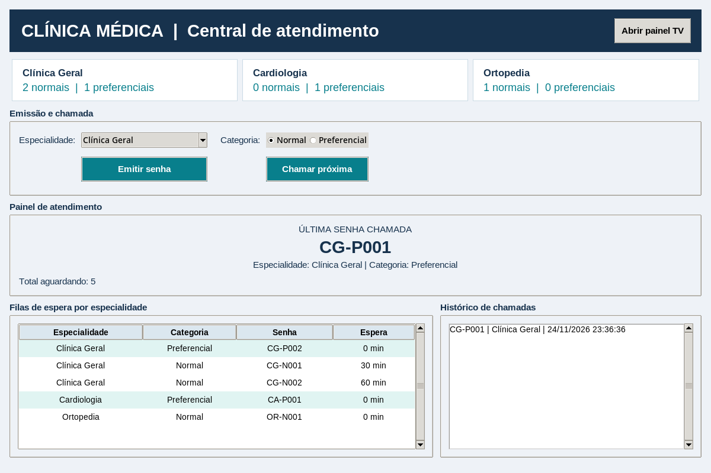
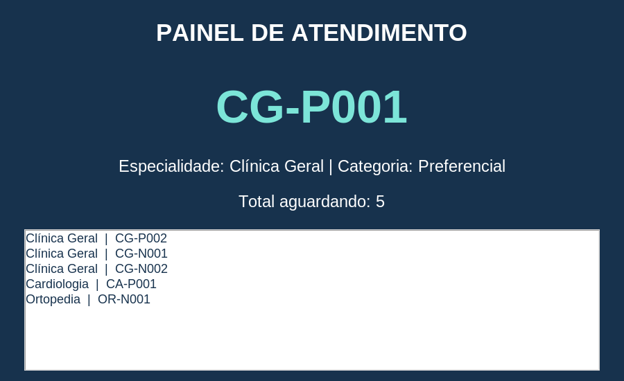

# Sistema de Gerenciamento de Senhas — Clínica Médica

**Disciplina:** Estrutura de Dados II — Centro Universitário UDF  
**Professora:** Karla Sartin  
**Integrantes:** Pedro Alves, Miguel Barbosa.

## Objetivo

Aplicação desktop em Python/Tkinter para emitir, consultar e chamar senhas de três especialidades, utilizando filas FIFO e prioridade.

## Funcionalidades

- Especialidades: Clínica Geral (`CG`), Cardiologia (`CA`) e Ortopedia (`OR`).
- Emissão de senhas normais (`N`) e preferenciais (`P`), com contadores independentes por especialidade e categoria. Exemplos: `CG-N001`, `CG-P001`, `CA-N001`.
- Seis filas independentes, implementadas com `collections.deque`.
- Chamada da próxima senha de uma especialidade, com preferência para a categoria `P`.
- Painel com última senha chamada, especialidade, categoria, total aguardando e relação de senhas em espera.
- Histórico das chamadas realizadas durante a execução.
- Consulta de estimativa de espera para uma senha ainda na fila.
- Avisos para fila vazia, senha inexistente, campos vazios e opções inválidas.

## Política de prioridade

Para **cada especialidade**, a fila preferencial é atendida **antes** da normal. Dentro de cada categoria, vale a ordem FIFO (primeiro a entrar, primeiro a sair). Exemplo: após emitir `CG-N001`, `CG-P001`, `CG-P002`, `CG-N002`, a ordem de chamada será `CG-P001`, `CG-P002`, `CG-N001`, `CG-N002`. Filas de especialidades distintas não interferem entre si.

A política é de **prioridade absoluta, sem alternância**: enquanto houver senhas preferenciais na especialidade, as normais aguardam.

## Estimativa de espera

Hipóteses: **um profissional atendendo por especialidade**, consultas sequenciais, duração média de **30 minutos por atendimento**, nenhuma consulta já em andamento considerada no cálculo e nenhuma previsão de chegadas futuras. A estimativa representa **minutos até a chamada**, não o fim da consulta.

`estimativa = quantidade de senhas à frente na ordem atual × 30 minutos`

Exemplo: se a ordem de espera atual for `CG-P001`, `CG-N001`, então a estimativa é de 0 minuto para `CG-P001` e 30 minutos para `CG-N001`. **Novas senhas preferenciais podem aumentar a estimativa das senhas normais.** É uma aproximação, não um horário garantido.

## Estruturas de dados

- `deque`: filas FIFO; `append` insere no final e `popleft` remove do início.
- Dicionários: organizam as filas e os contadores por especialidade e categoria.
- Lista: armazena o histórico de chamadas da sessão.


## Estrutura do projeto

sistema_clinica/
├── controllers/
│   └── filas.py
├── views/
│   └── interface.py
├── imagens/
│   ├── interface.png
│   └── painel.png
├── tests/
│   └── test_filas.py
├── .gitignore
├── main.py
└── README.md

- `controllers/filas.py`: gerenciamento das filas, senhas e prioridades.
- `views/interface.py`: interface gráfica em Tkinter.
- `main.py`: inicialização do sistema.
- `tests/test_filas.py`: testes automatizados.
- `imagens/`: capturas da interface gráfica.
- `README.md`: documentação do projeto.
- `.gitignore`: arquivos ignorados pelo Git.o.

## Instalação e execução

Requisitos: Python 3 com Tkinter (normalmente incluído na instalação padrão do Python para Windows). Não há dependências de terceiros.

1. Baixe e extraia a pasta do projeto.
2. Abra a pasta no VS Code.
3. Abra o terminal **dentro da pasta `sistema_clinica_medica`**.
4. Execute:

```bash
python main.py
```

Se o comando `python` não funcionar no Windows, tente `py main.py`.

### Testes automáticos

No terminal, dentro da pasta do projeto:

```bash
python -m unittest discover -s tests -v
```

## Teste manual sugerido para a apresentação

1. Em Clínica Geral, emita duas senhas normais e duas preferenciais.
2. Confira as quatro senhas no painel.
3. Chame quatro vezes e observe que as preferenciais saem primeiro, em FIFO, depois as normais.
4. Confira o histórico e a última chamada.
5. Emita uma senha em Cardiologia e outra em Ortopedia; verifique a independência.
6. Consulte a estimativa de uma senha em espera.
7. Tente chamar uma fila vazia e consultar uma senha inexistente para demonstrar os avisos.

## Imagens da interface

Capturas reais da aplicação executada com dados de demonstração em ambiente gráfico virtual Linux. A aparência pode variar no Windows.





A central apresenta indicadores por especialidade e estimativas atualizadas na tabela. O botão **Abrir painel TV** abre uma segunda janela sincronizada, que pode ser movida para outro monitor. Os dados permanecem em memória durante a sessão.

